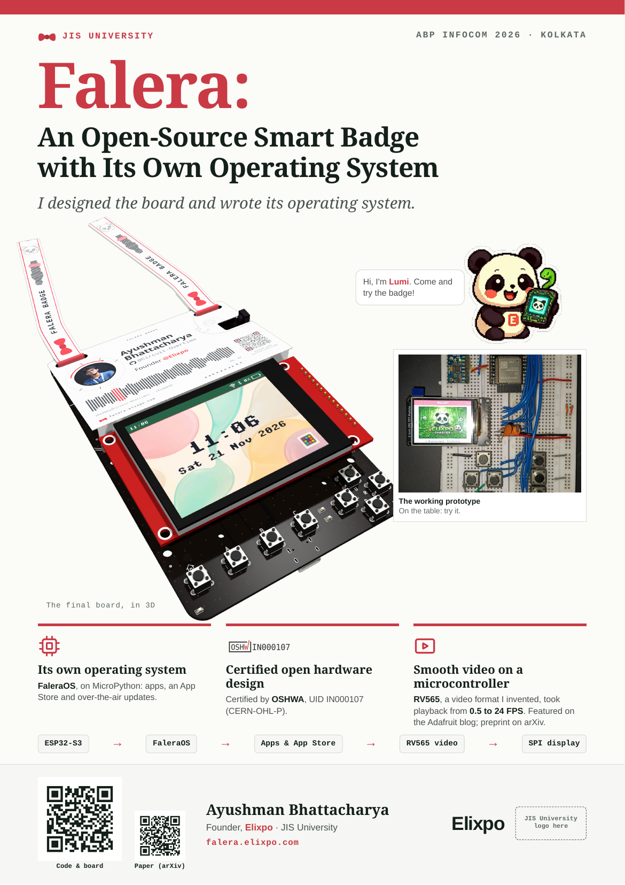

# ABP Infocom 2026: poster and QR cards

For the JIS University stall at ABP Infocom 2026, Hyatt Regency, Kolkata,
28 November 2026. Project title (official, from the nomination):
**"Falera: An Open-Source Smart Badge with Its Own Operating System"**.



## Print files (`out/`)

| File | What |
| --- | --- |
| `poster-a3.pdf` | A3 portrait, 297 × 420 mm, no bleed |
| `poster-a3-bleed3mm.pdf` | the same with 3 mm bleed on every side (303 × 426 mm), if the print shop asks |
| `poster-a3-cmyk.pdf` | the no-bleed poster converted to CMYK (made by `make_poster.py`, not in git) |
| `qr-cards-a4.pdf` | ten 85 × 55 mm QR cards on A4, with crop marks |
| `*-preview.png` | previews at 100 dpi |

Images print above 300 dpi: the hero at 331 dpi, the prototype photo at
376 dpi, Lumi (pixel art, tripled) above 600 dpi. Both QR codes decode from
a 300 dpi raster of the RGB and the CMYK PDF; the main one is 40 × 40 mm.

## Sources

| File | What |
| --- | --- |
| `poster.html` | the poster, in millimetres; edit the text here |
| `cards.html` | the QR card (one `<template>`, repeated ten times) |
| `make_poster.py` | prints both to PDF, makes the bleed and CMYK copies and the previews |
| `make_qr.py` | writes `assets/qr-github.svg` and `assets/qr-arxiv.svg` |
| `render_hero.py` | renders the badge in 3D (kicad-cli, 3000 px, transparent), with Ayushman's card and the lanyard, from `circuit/elixpo/render_board.py`'s models |
| `compose_hero.py` | puts FaleraOS's real home screen on the display (exact perspective) and drops kicad-cli's ground shadow → `assets/hero-final.png` |

```
python3 render_hero.py      # only if the board changes (about a minute)
python3 compose_hero.py     # needs opencv-python
python3 make_qr.py          # needs qrcode
python3 make_poster.py      # needs headless Chromium, Ghostscript, pdftoppm
```

**JIS University logo:** put the official file at `assets/jis-logo.png` (don't
redraw it) and run `make_poster.py`: it replaces the dashed slot bottom right.

## Claims on the poster

They follow the rules from the handoff: "0.5 to 24 FPS" is the standalone
firmware path (inside FaleraOS it is 12.2 FPS, never claimed here); Adafruit
*featured* RV565; the paper is an arXiv *preprint*; OSHWA certified the
*board design* (IN000107, CERN-OHL-P). RV565 on CircuitPython is left off.

## Before printing

- [ ] The JIS University logo is in.
- [ ] Ask the print shop: bleed or no bleed, RGB or CMYK PDF.
- [ ] Scan both QR codes from the printed proof.
- [ ] Print by 27 November: A3 on thick or laminated paper, or on foam
      board / in a clip frame; 20 to 30 QR cards (two or three A4 sheets).
