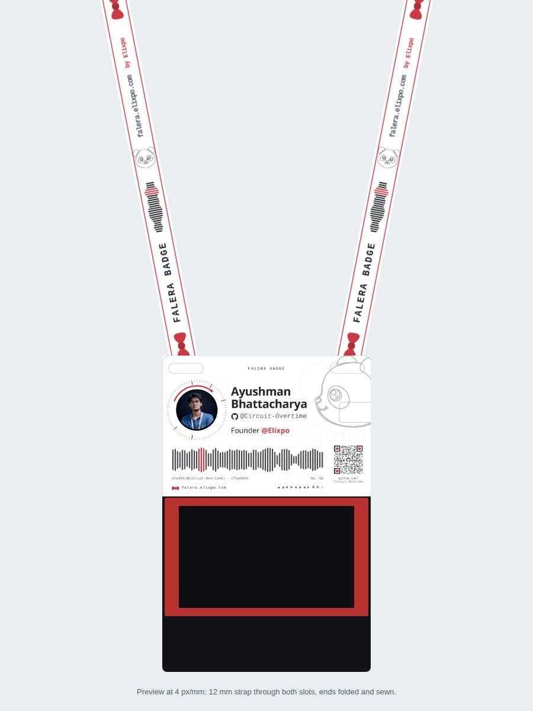

# Lanyard

The Falera Badge lanyard: a 12 mm strap through both lanyard slots, printed on
one side in the name card's ink and red.

| File | What |
| --- | --- |
| `lanyard-print.svg` | the artwork, 950 × 12 mm, for the printer |
| `lanyard-guides.svg` | the artwork with the fold, sew and centre lines marked |
| `renders/lanyard-print.pdf` | the artwork as a PDF at 950 × 12 mm (fonts embedded) |
| `renders/detail.png` | the first 330 mm, enlarged |
| `renders/preview.png` | the lanyard on the badge, with Ayushman's card |
| `make_lanyard.py` | regenerates all of these |

Run `python3 make_lanyard.py` (needs a headless Chromium, as for
`name-card/make_cards.py`, and `pdftoppm`).

## Dimensions

| | mm | Why |
| --- | ---: | --- |
| Strap width | 12 | the badge's slots are 13.6 × 3.3 mm: 12 mm leaves 0.8 mm a side, and the folded strap (two layers) passes the 3.3 mm height |
| Printed length | 950 | 900 mm shows, around the neck |
| Fold, each end | 25 | goes through a slot and back (red, no pattern) |
| Sew line | 12 from each end | stitch the fold shut here |
| Artwork clear of the long edges | 1.2 | for sublimation registration; the red edge stripes sit on this line |

Strap material: polyester for dye sublimation, about 1 mm thick or less, so the
fold fits the slot. Check a sample through a real board's slot before ordering.

## The pattern

One 138.5 mm module, three times on each half, spaced evenly:
the bow, **FALERA BADGE**, a piece of the waveform, Lumi (facing the viewer, upright when worn;
`assets/lumi-front.png`, from `circuit/elixpo/art/lumi-front-lineart.png`), `falera.elixpo.com`
and "by Elixpo". The waveform pieces are consecutive slices of one sequence
(SHA-256 of `falera:<n>`, smoothed like the card's), so they read as one band
broken by the text; each piece's peak is red.

The second half is the first turned 180° about the centre, with a bow on the
centre line at the neck, alone in a 24 mm clear zone. Worn, both sides read the same way, from the badge
up.
